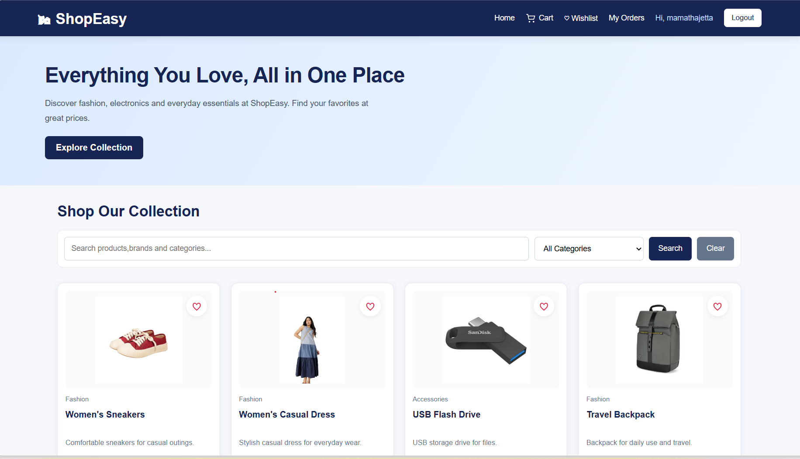
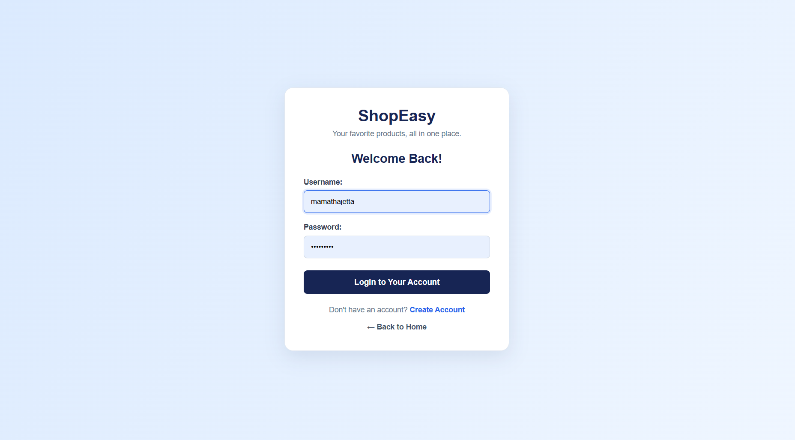
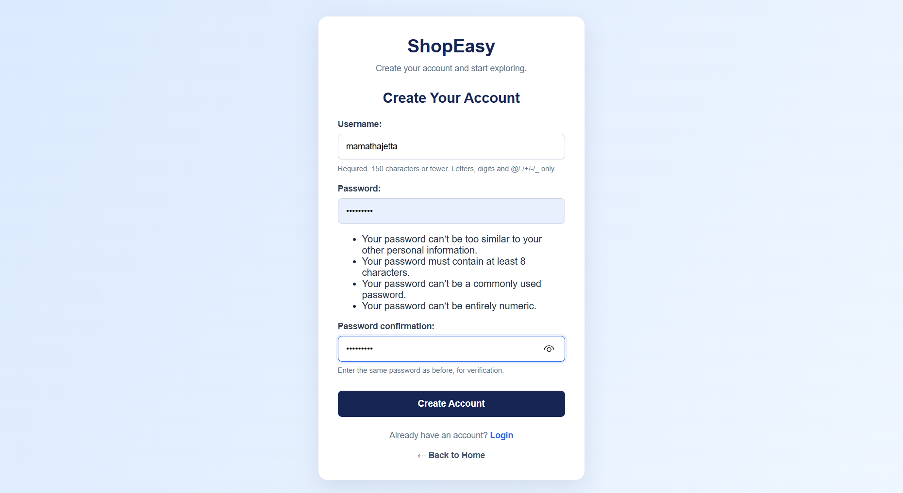
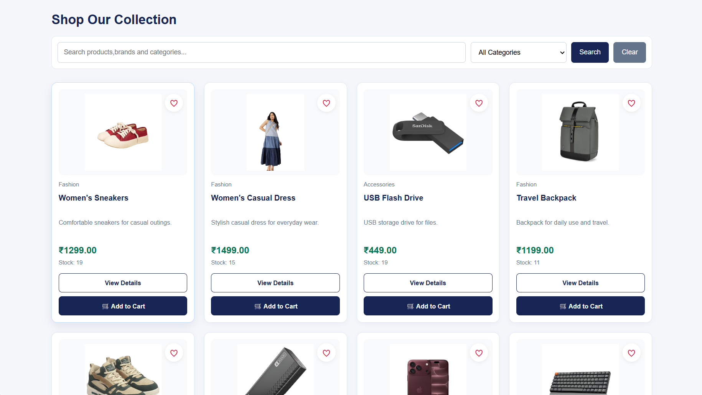
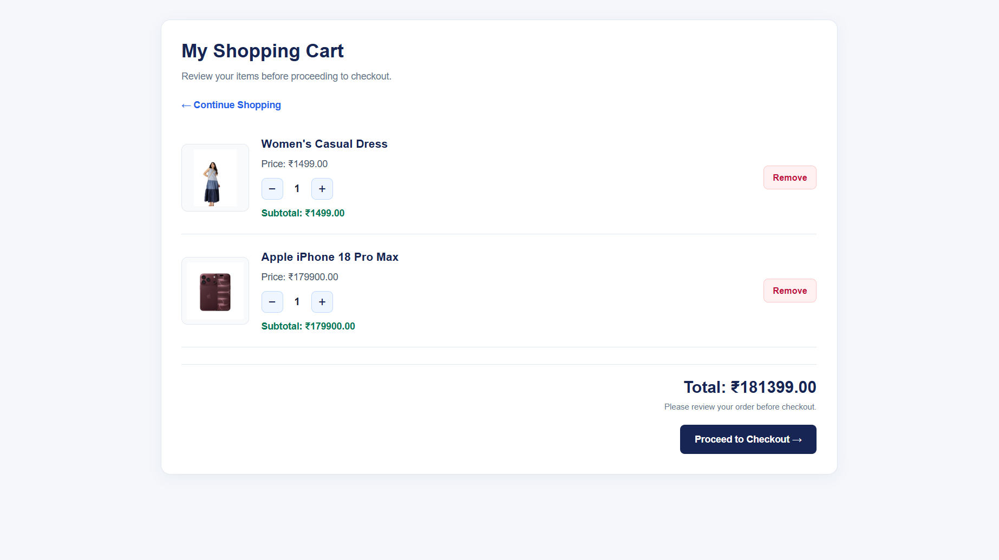
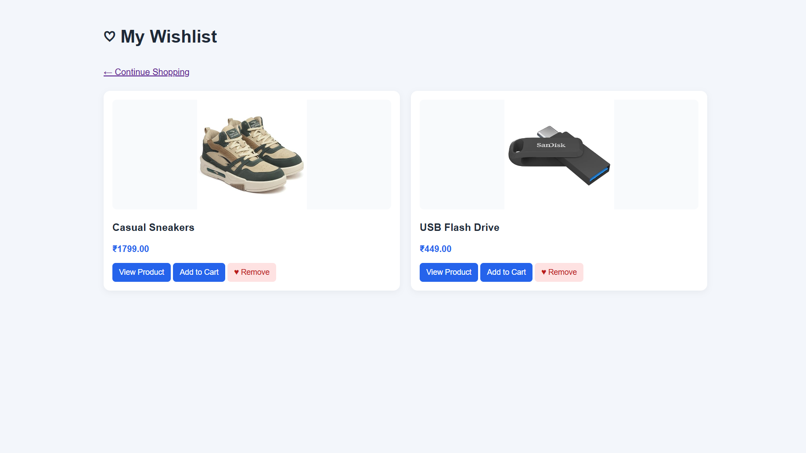
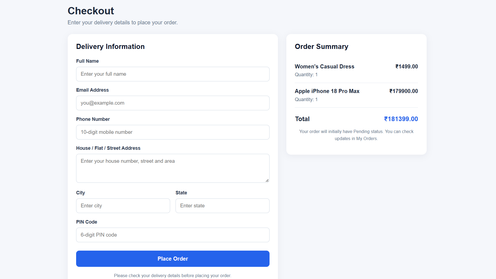
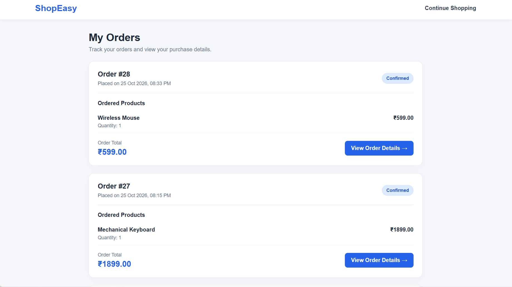
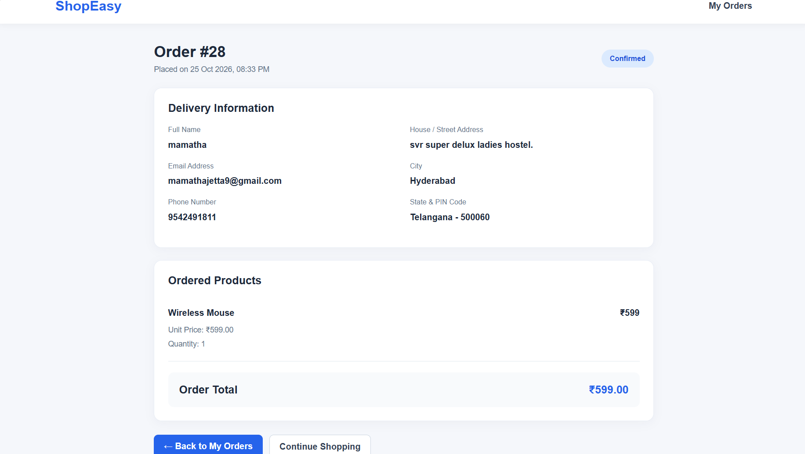

# ShopEasy - Ecommerce Website

ShopEasy is an ecommerce website developed using Python, Django, MySQL, HTML, CSS, and JavaScript.

## Technologies Used
- Python
- Django
- MySQL
- HTML
- CSS
- JavaScript
- Django Templates
- Pillow

## Features
- User Registration and Login
- Product Listing and Product Details
- Product Search and Categories
- Shopping Cart Management
- Checkout and Order Placement
- Order History and Order Details
- Product Stock Management
- Admin Panel

## Installation

1. Clone the repository.
2. Create and activate a virtual environment.
3. Install the dependencies using `pip install -r requirements.txt`.
4. Configure your database and `.env` file.
5. Run migrations using `python manage.py migrate`.
6. Start the server using `python manage.py runserver`.

## Developer
Mamatha Jetta

## 📸 Project Screenshots

### Home Page

### Login Page

### Registration Page

### Product Details

### my Cart

### Wishlist

### Checkout

### My Orders

### Order Details
